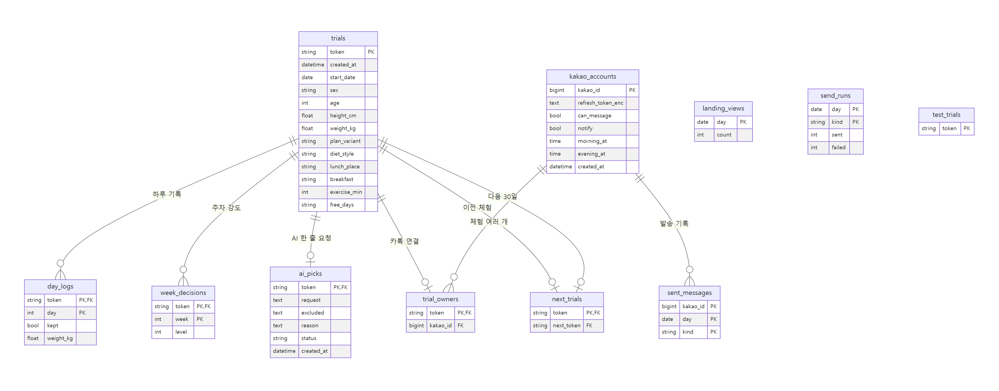
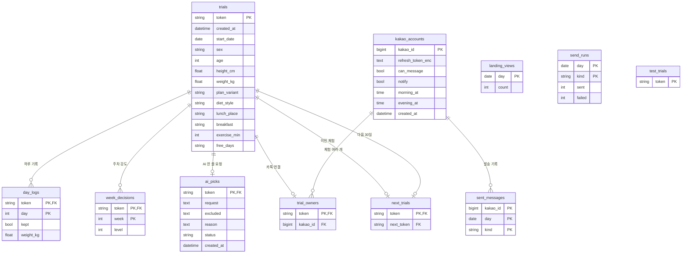
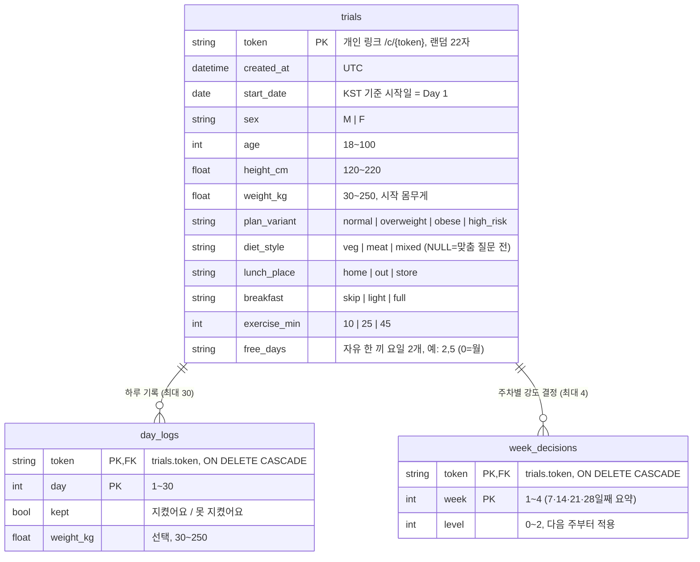
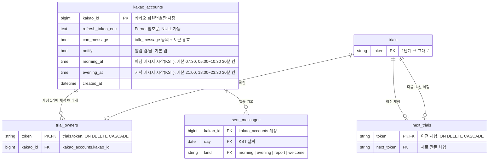
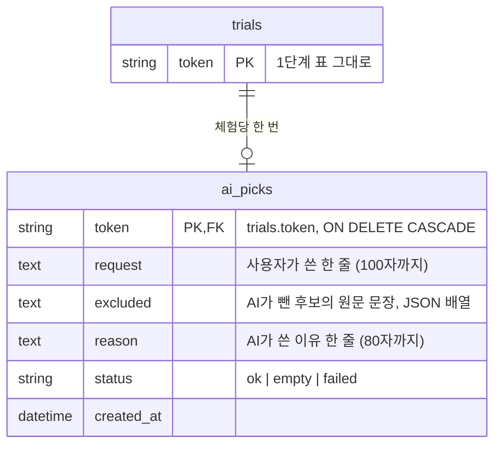
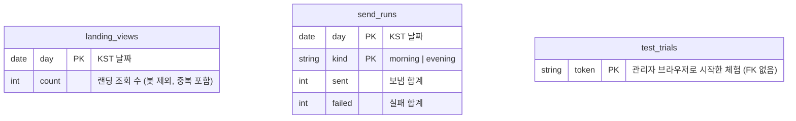

# ERD

- 기준: `app/models.py` (SQLAlchemy 2.0, 운영 PostgreSQL 16 / 로컬·테스트 SQLite)
- 표 생성: 앱 시작 시 `Base.metadata.create_all` (마이그레이션 도구 없음 → 2단계부터는 **새 표만 추가**, 기존 표 변경 없음). 지금 표 11개: 1단계 3 · 2단계 4 · 3단계 1 · 운영 지표 3
- 개인 식별 정보(이름·연락처·이메일)는 어느 표에도 없어요. 체험은 추측 불가능한 토큰(`secrets.token_urlsafe(16)`, 22자)으로만 찾아요.

## 0. 전체 한눈에 (표 11개)

- 가운데 `trials`(체험)가 중심이에요. 1단계 기록 2개·AI 1개·카카오 연결이 모두 `token`으로 이어져요.
- 오른쪽 위 3개(`landing_views`·`send_runs`·`test_trials`)는 운영 지표용이라 다른 표와 FK가 없어요. `test_trials.token`은 체험 토큰을 적어 두기만 해요.
- 이미지 원본은 아래 Mermaid예요(GitHub에서 바로 그려져요). 열 설명은 1~4장에 있어요.

Mermaid 원본

## 1. 1단계 표 — ✅ 구현, 운영 중

| 표 | 역할 | 키·제약 |
|---|---|---|
| `trials` | 30일 체험 1건 = 몸 정보 + 맞춤 답변 5개 + 계획 종류 | PK `token`. `free_days`가 NULL이면 맞춤 질문 전(`setup_done = False`) |
| `day_logs` | 하루 체크 기록 | 복합 PK (`token`, `day`) → 같은 날 기록은 하나, 다시 누르면 덮어씀 |
| `week_decisions` | 주간 요약에서 고른 강도 | 복합 PK (`token`, `week`) → 주차마다 한 번만 결정 |

- 계획(식단·운동·팁)은 **표에 저장하지 않아요.** `build_plan(답변, 시작일, token 시드, 강도 결정)`으로 매번 같은 결과를 계산해요.
- 보관: 시작 후 120일(체험 30일 + 90일)이 지난 체험과 기록을 매일 삭제(`scripts/purge.py`).

## 2. 2단계 표 (카카오 로그인 + 하루 두 번 카톡) — ✅ 구현, 2026-11-17 운영 반영

출처: `docs/superpowers/specs/2026-11-16-watchme-phase2-design.md` 7장, `docs/superpowers/plans/2026-11-16-watchme-phase2.md` Task 3.

| 표 | 역할 | 핵심 규칙 |
|---|---|---|
| `kakao_accounts` | 카카오 계정 | 닉네임·이메일 없음. 액세스 토큰은 저장 안 함(발송 때마다 리프레시 토큰으로 발급) |
| `trial_owners` | 체험 ↔ 계정 연결 | 다른 계정에 이미 연결된 체험은 거절 |
| `sent_messages` | 중복 발송 방지 | (계정, 날짜, 종류)를 **먼저 insert** → 이미 있으면 건너뜀. cron이 두 번 돌아도 한 통 |
| `next_trials` | "다음 30일 도전" 한 번만 | 같은 체험에서 두 번 눌러도 같은 새 체험으로 이동 |

- 연결 끊기: 카카오 unlink 호출(실패해도 진행) → `trial_owners`·`sent_messages`·`kakao_accounts` 행 삭제. 체험과 기록은 그대로.
- 보관 삭제 확장: 체험이 지워지면 연결도 지워지고, 남은 체험이 없는 계정은 계정 행과 발송 기록까지 삭제.

## 3. 3단계 표 (AI 한 줄 요청) — ✅ 구현, 2026-11-18 운영 반영

출처: `docs/superpowers/specs/2026-11-18-watchme-phase3-ai-design.md` 4.3장, `app/models.py` `AiPick`.

| 표 | 역할 | 핵심 규칙 |
|---|---|---|
| `ai_picks` | 설정 때 받은 한 줄 요청과 AI 결과 | `status = ok`일 때만 계획에서 `excluded` 문장을 빼요. 번호가 아니라 **원문 문장**으로 저장 → 메뉴 파일 순서가 바뀌어도 안전 |

- 계획은 여전히 저장하지 않아요. `plan_for(db, trial)` = `build_plan(답변, 시작일, token 시드, 강도 결정, AI 제외 문장)`. 기록 화면·주간 PDF·아침 카톡이 모두 이 함수 하나를 거쳐요.
- 실패(`failed`)도 남겨요(화면 안내용). 실패 이유는 서버 로그에 종류만(timeout / http / invalid).
- 보관 삭제: 체험과 함께 `ai_picks`도 지워요. 다음 30일 도전은 이 행을 그대로 복사(AI 재호출 없음).

## 4. 운영 지표 표 — ✅ 구현, 2026-11-18 운영 반영

출처: `docs/superpowers/specs/2026-11-18-watchme-admin-metrics-design.md`, `app/models.py`.

| 표 | 역할 | 핵심 규칙 |
|---|---|---|
| `landing_views` | 날짜별 랜딩 조회 수 | 누가 봤는지(IP·쿠키·브라우저 정보)는 저장하지 않아요 |
| `send_runs` | 카톡 cron 발송 결과 | 계정 정보 없이 합계만 |
| `test_trials` | 내 테스트 체험 표시 | 지표에서 빼요. 다음 30일 도전에도 이어지고, 체험이 보관 기간 끝에 지워질 때 함께 지워요 |

- 세 표 모두 서버가 켜질 때 자동으로 만들어져요. 기존 표는 바꾸지 않았어요.
- 집계는 `/admin`을 열 때마다 `app/metrics.py` `collect()`가 해요(캐시 없음).
