# 와이어프레임

- 기준: `app/templates/*.html` (실제 화면 문구 그대로), 실제 화면은 https://evrd.fyi
- 캡처: `screenshots/` — 로컬 서버에 예시 데이터를 넣고 폰 화면(390px, 2배)으로 찍었어요(2026-11-19). 숫자는 예시 인물·예시 데이터 값이에요. 각 절의 "텍스트 설계도"를 펼치면 조건별 설명이 있어요.
- 공통 레이아웃(`base.html`): **위 초록 영역**(브랜드·제목·핵심 숫자) + **아래 흰 시트**(카드들, 맨 아래 면책 문구) + **아래 고정 둥근 주 버튼**. 폭 최대 480px, 폰 우선, **항상 밝은 화면**(다크 모드 반영 안 함, 2026-11-18).
- 기록 화면만 초록 영역 위에 **카톡 바**(`topbar` 블록)가 한 줄 더 있어요.

## 1. 화면 흐름

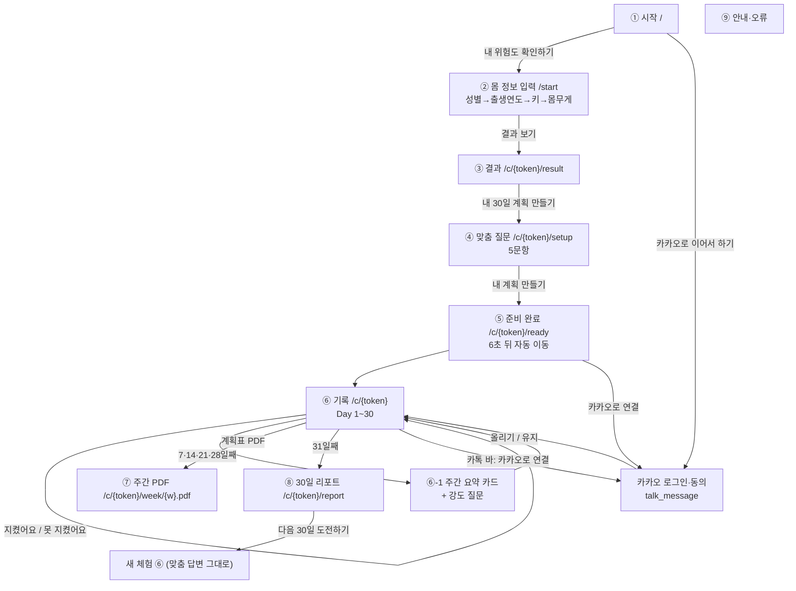

- 맞춤 질문을 안 끝낸 체험이 기록·리포트·PDF에 오면 ④로 돌려보내요.
- 매일 07:30·21:00 카톡 메시지의 버튼은 ⑥(31일째 아침은 ⑧)으로 연결돼요.

## 2. 화면별 와이어프레임

### ① 시작 화면 `/` (`landing.html`, 2026-11-18 스토리형 개편)

인스타 스토리처럼 장면이 자동으로 넘어가요(3.0·3.6·3.8·4.6초, 마지막 장면에서 멈춤).

<p>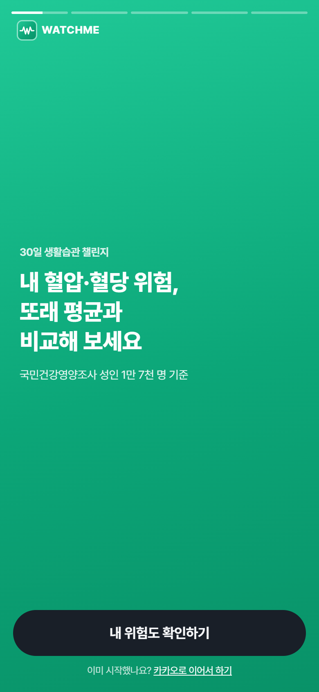 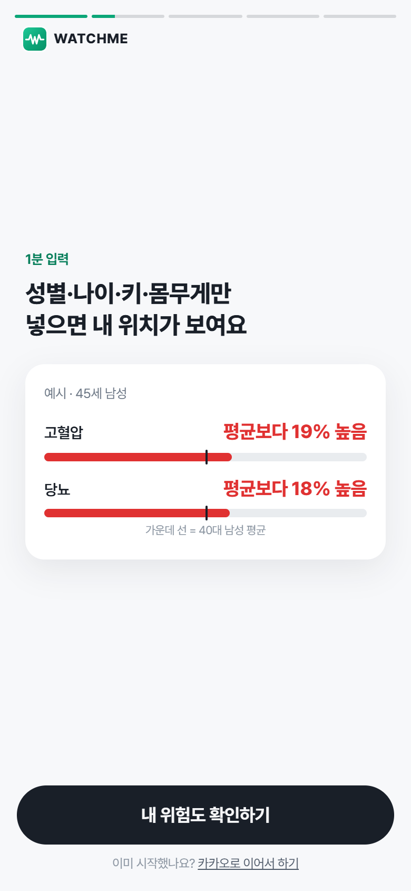 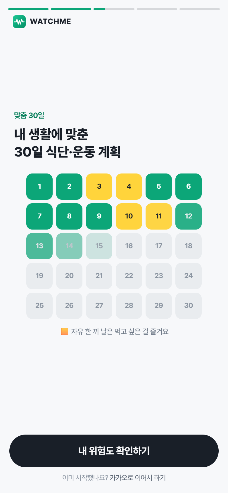 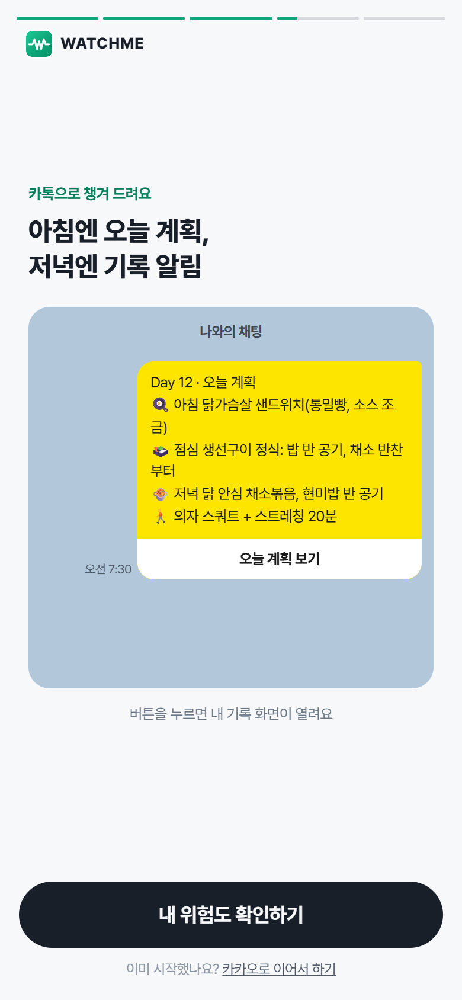</p>

<details><summary>텍스트 설계도(설명 포함)</summary>

```
┌──────────────────────────────┐
│ ▬▬ ▬▬ ▬▬ ▬▬ ▬▬               │ ← 진행 막대: 칸을 누르면 그 장면으로
│ [W] WATCHME                   │ ← 맥박 W 아이콘
│                              │
│  장면 1 (초록) 30일 생활습관 챌린지 │
│   내 혈압·혈당 위험, 또래 평균과 비교해 보세요 │
│  장면 2 (흰) 1분 입력 — 예시 45세 남성 막대가 차오름 │
│  장면 3 (흰) 맞춤 30일 — 30칸 달력이 차례로 채워짐(자유 한 끼 노랑) │
│  장면 4 (흰) 카톡으로 챙겨 드려요 — '나와의 채팅' 07:30 계획·21:00 기록 알림 │
│           (실제 발송 문장·버튼 그대로, 답장 없음, 카카오 켜졌을 때만) │
│  장면 5 (초록) 지금 내 위험도부터 확인해 볼까요? │
│           [접힌 카드] 🔒 이름·연락처는 받지 않아요 ▸ · (면책 문구) │
│                              │ ← 화면을 누르면 다음 장면
├──────────────────────────────┤
│ [ 내 위험도 확인하기 ]  (검정) │ ← 고정 버튼
│ 이미 시작했나요? 카카오로 이어서 하기 │ ← 작은 글씨, 카카오 켜졌을 때만
└──────────────────────────────┘
```

</details>
- JS가 꺼져 있으면 장면이 위에서 아래로 쌓여 보여요. '움직임 줄이기' 설정이면 자동으로 넘어가지 않아요.
- 통계 파일이 없으면 카드 대신 "준비 중 · 한국 평균 통계 데이터를 준비하고 있어요", 버튼 숨김.

### ② 몸 정보 입력 `/start` (`start.html` + `flow.js`)

<p>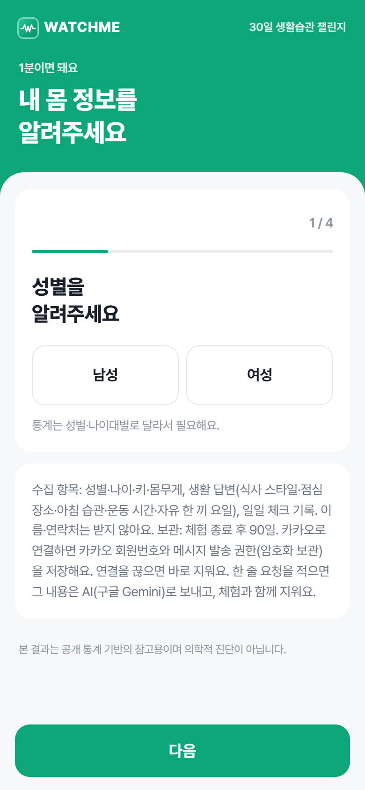</p>

<details><summary>텍스트 설계도(설명 포함)</summary>

```
┌──────────────────────────────┐
│ 1분이면 돼요                  │
│ 내 몸 정보를 알려주세요        │
├──────────────────────────────┤
│ ←  ▓▓▓▓░░░░░░░░  1/4          │ ← 진행 막대
│                              │
│ 성별을                        │
│ 알려주세요                    │
│  ┌─────────┐ ┌─────────┐     │
│  │  남성   │ │  여성   │     │ ← 누르면 바로 다음
│  └─────────┘ └─────────┘     │
│ 통계는 성별·나이대별로 달라서 필요해요. │
│ ── 답한 항목(누르면 돌아감) ── │
├──────────────────────────────┤
│ [ 다음 ] → 마지막 질문에서 [ 결과 보기 ] │
└──────────────────────────────┘
```

</details>

| 단계 | 질문 | 입력 | 안내 |
|---|---|---|---|
| 1/4 | 성별을 알려주세요 | 남성 / 여성 | 통계는 성별·나이대별로 달라서 필요해요. |
| 2/4 | 태어난 해를 알려주세요 | 숫자 키패드 `____ 년` (예시 1980) | 1926~2008년 사이로 입력해 주세요. (올해 기준 자동 계산) |
| 3/4 | 키는 몇 cm인가요? | `___ cm` | 120~220cm 사이로 입력해 주세요. |
| 4/4 | 몸무게는 몇 kg인가요? | `___ kg` | 30~250kg 사이로 입력해 주세요. |

- 질문 사이 좌우 슬라이드. JS가 꺼지면 4문항이 한 화면 일반 폼. 서버 오류는 맨 위 빨간 안내(`role="alert"`).

### ③ 결과 `/c/{token}/result` (`result.html`)

<p>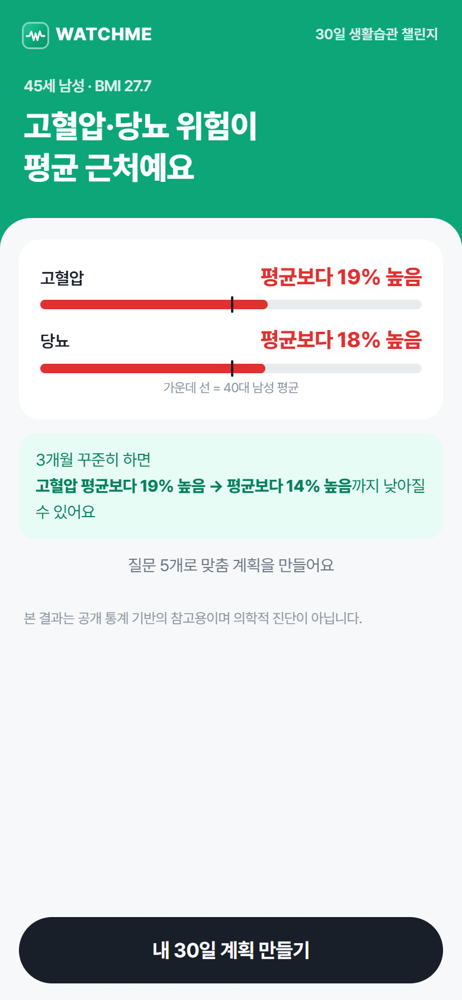</p>

<details><summary>텍스트 설계도(설명 포함)</summary>

```
┌──────────────────────────────┐
│ 45세 남성 · BMI 27.7          │
│ 고혈압·당뇨 위험이            │
│ 평균보다 높은 편이에요         │ ← 수준별 3가지 문장
├──────────────────────────────┤
│ [카드] 고혈압 / 당뇨 막대 2개  │
│ ┌ 3개월 꾸준히 하면            │
│ └ 당뇨 평균보다 N% 높음 → M% 높음까지 낮아질 수 있어요 │
│   질문 5개로 맞춤 계획을 만들어요 │
├──────────────────────────────┤
│ [ 내 30일 계획 만들기 ]        │
└──────────────────────────────┘
```

</details>
- 제목: 둘 다 낮음 → "평균보다 낮아요 👏" / 하나라도 높음 → "○○ 위험이 평균보다 높은 편이에요" / 그 외 → "평균 근처예요".
- BMI 23 미만이면 시나리오 대신 "지금 체중이 좋아요. 목표는 30일 습관 유지예요."

### ④ 맞춤 질문 `/c/{token}/setup` (`setup.html`)

제목: "맞춤 계획 · 생활에 맞춰 30일 계획을 짜 드릴게요". ②와 같은 한 질문씩 방식.
<p>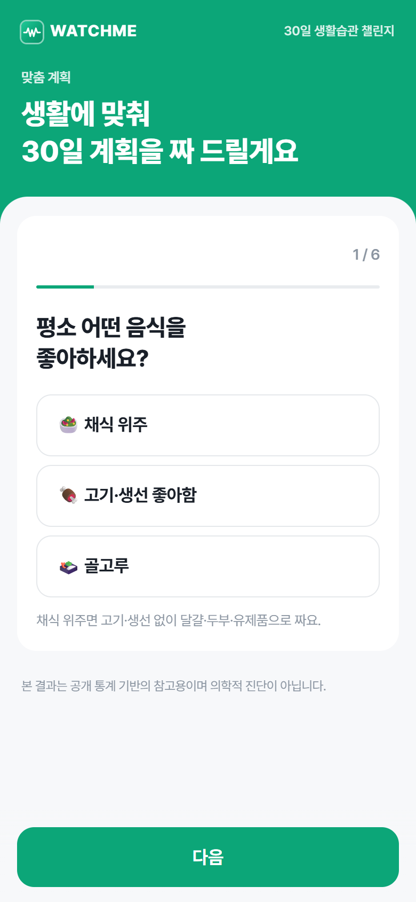 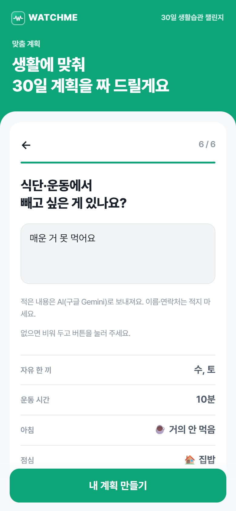</p>


| 단계 | 질문 | 선택지 | 안내 |
|---|---|---|---|
| 1/5 | 평소 어떤 음식을 좋아하세요? | 🥗 채식 위주 / 🍖 고기·생선 좋아함 / 🍱 골고루 | 채식 위주면 고기·생선 없이 달걀·두부·유제품으로 짜요. |
| 2/5 | 점심은 주로 어디서 드세요? | 🏠 집밥 / 🏢 회사·외식 / 🏪 편의점 | 외식·편의점이면 메뉴 고르는 요령으로 알려 드려요. |
| 3/5 | 아침은 어떻게 드세요? | ☕ 거의 안 먹음 / 🍌 간단히 / 🍚 챙겨 먹음 | 안 먹는 편이면 아주 간단한 것부터 시작해요. |
| 4/5 | 하루에 운동할 시간은 얼마나 되세요? | 10분 / 20~30분 / 1시간 | 첫 주는 가볍게 시작해서 조금씩 늘려요. |
| 5/5 | 자유 한 끼 요일 2개를 골라 주세요 | 월 화 수 목 금 토 일 (2개) | 고른 요일 저녁엔 먹고 싶은 걸 즐겨요 🎉 |
| 6/6 (3단계, 선택) | 식단·운동에서 빼고 싶은 게 있나요? | 여러 줄 입력칸 100자, "예: 매운 거 못 먹어요, 무릎이 안 좋아요" | 적은 내용은 AI(구글 Gemini)로 보내져요. 이름·연락처는 적지 마세요. / 없으면 비워 두고 버튼을 눌러 주세요. |

버튼: [ 내 계획 만들기 ]

- 6단계는 서버에 `GEMINI_API_KEY`가 있을 때만 보여요(없으면 5문항 그대로). 버튼을 누르면 AI 응답을 최대 8초 기다린 뒤 ⑤로 가요.

### ⑤ 준비 완료 `/c/{token}/ready` (`ready.html`)

<p>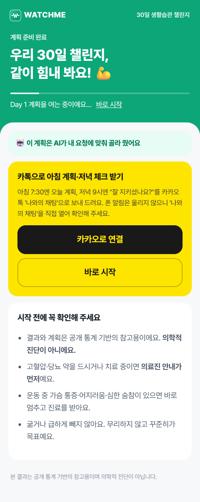</p>

<details><summary>텍스트 설계도(설명 포함)</summary>

```
┌──────────────────────────────┐
│ 계획 준비 완료                │
│ 우리 30일 챌린지,             │
│ 같이 힘내 봐요! 💪            │
│ ▓▓▓▓▓▓▓░░░ (6초 진행 막대)    │
│ Day 1 계획을 여는 중이에요… 바로 시작 │
├──────────────────────────────┤
│ [초록 안내] 🤖 이 계획은 AI가 내 요청에 맞춰 골라 줬어요 │ ← 3단계: 한 줄 요청을 적었을 때만
│ [노란 카드] 카톡으로 아침 계획·저녁 체크 받기 │ ← 카카오 키가 있고 미연결일 때만
│  폰 알림은 울리지 않으니 '나와의 채팅'을 직접 열어 확인 │
│              [ 카카오로 연결 ] │ ← 이때는 자동 이동 안 함
│              [ 바로 시작 ]     │ ← 카카오 없이 시작 (테두리 버튼)
│ [카드] 시작 전에 꼭 확인해 주세요 │
│  • 의학적 진단이 아니에요      │
│  • 치료 중이면 의료진 안내가 먼저 │
│  • 운동 중 가슴 통증·어지러움 → 멈추고 진료 │
│  • 굶거나 급하게 빼지 않아요    │
└──────────────────────────────┘
```

</details>
- 3단계 AI 안내(한 줄 요청을 적었을 때만, 무엇을 뺐는지는 안 보여 줌): 반영 → 위 초록 안내 / 뺄 게 없음 → "요청을 확인했어요. 지금 계획에서 뺄 게 없었어요." / 실패 → "지금은 AI 요청을 반영하지 못했어요. 기본 계획으로 시작해요."

### ⑥ 기록 `/c/{token}` (`check.html`) — 매일 쓰는 화면

<p>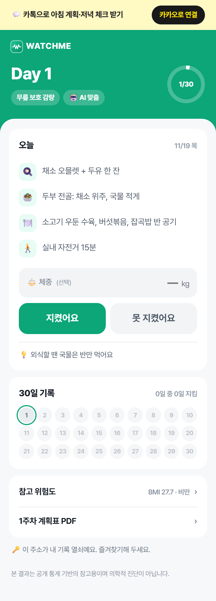</p>

<details><summary>텍스트 설계도(설명 포함)</summary>

```
┌──────────────────────────────┐
│ 💬 카카오톡 연결됨 · 아침 7:30 / 저녁 9시  설정 ▸ │ ← 카톡 바(카톡 노랑), 맨 위
├──────────────────────────────┤
│ WATCHME        ◯ 5/30 (진행 링)│ ← 초록 영역
│ Day 5                         │
│ [가벼운 감량] [💪 강도 1단계] [🔥 5일 연속] [🤖 AI 맞춤] │ ← 칩
├──────────────────────────────┤
│ [주간 요약 카드] ← 7·14·21·28일째 │
│ [카드] 오늘  11/20 목          │
│  🍳 …                         │
│  🥗 …                         │
│  🍽️ … (자유 한 끼 날: 🎉 + 요령) │
│  🚶 …                         │
│  ⚖️ 체중 (선택) [____] kg     │ ← 일요일: "오늘은 체중 재는 날"
│  [ 지켰어요 ] [ 못 지켰어요 ]  │
│  ✅ 지켰어요 · 다시 누르면 바뀌어요 │
│  💡 오늘의 팁 한 줄            │
│ [카드] 🕵️ 잠깐, 정말 다 지켰어요? │ ← 정체 조건일 때만
│ [카드] 30일 기록  5일 중 5일 지킴 │
│  ① ② ③ ④ [5] 6 7 … 30        │ ← 도장판(초록/연빨강/흐림), 누르면 그날로
│ [ 30일 변화 리포트 보기 🎉 ]   │ ← 31일째부터
│ [목록] 참고 위험도 BMI · 구간 ▸ │ ← 접힘
│        1주차 계획표 PDF        │
│ 🔑 이 주소가 내 기록 열쇠예요.  │ ← 카카오 미연결일 때만
└──────────────────────────────┘
```

</details>
- 카톡 바(카카오 키가 있을 때만, 31일째부터는 숨김):
  - 미연결: "💬 카톡으로 아침 계획·저녁 체크 받기" + [카카오로 연결]
  - 연결 끊김/동의 없음: "⚠️ 카톡 연결이 끊겼어요" / "⚠️ 카톡 메시지 동의가 없어요" + [다시 연결]
  - 연결됨: "💬 카카오톡 연결됨 · 아침 7:30 / 저녁 9시", 설정을 펼치면 "폰 알림은 울리지 않아요. 카톡 '나와의 채팅'을 직접 열어 확인해 주세요." + 메시지 끄기 · 연결 끊기
  - 끔: "🔕 카톡 메시지 꺼짐", 설정에서 메시지 켜기 · 연결 끊기
- 지난 날을 열면(`?day=n`) 제목이 "Day n", 밑에 "지난 날 기록 · 오늘은 Day N", 시트 맨 위에 **주황 띠** "📝 지난 기록을 고치는 중이에요 · Day n (m/d 요일)" + "오늘(Day N)로 돌아가기 →". 저장하면 그 날 화면으로 돌아와요.
- 연속 칩은 2일 이상일 때만, 강도 칩은 강도를 올렸을 때만, 🤖 AI 맞춤 칩은 AI가 메뉴·운동을 실제로 뺐을 때만(3단계).
- 의심 카드: "꾸준히 지켰는데 체중이 그대로네요." + 원인 하나(음료 당 / 간식 / 소스·국물 / 양) + "물 무게 때문에 1~2주 정체는 흔해요."
- 카카오 연결 결과 안내(시트 맨 위 한 줄): 연결됐어요 ✅ / 연결을 취소했어요 / 메시지 동의가 없어서 알림을 보낼 수 없어요 / 다른 카카오 계정에 연결돼 있어요 / 연결을 끊었어요. 저장한 정보도 지웠어요.

#### ⑥-1 주간 요약 카드

<p>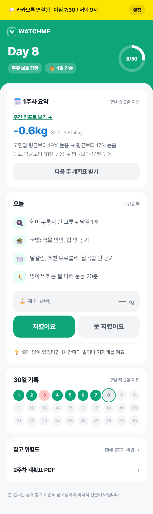</p>

<details><summary>텍스트 설계도(설명 포함)</summary>

```
│ 📅 1주차 요약   7일 중 6일 지킴  │
│  −0.8kg   82.0 → 81.2kg        │
│  고혈압 평균보다 N% → M%        │
│  당뇨   평균보다 N% → M%        │
│ ┌ 잘 지켰는데 체중이 그대로예요. │ ← 정체 조건일 때만
│ │ 다음 주는 조금 더 해볼까요?    │
│ │ • 저녁 밥 양 1/3 • 7시 이후 금식 • 운동 10분 더 │
│ └ [ 올리기 ] [ 이대로 유지 ]    │
│ [ 다음 주 계획표 받기 ]         │
```

</details>

### ⑦ 주간 계획표 PDF `/c/{token}/week/{w}.pdf`

<p>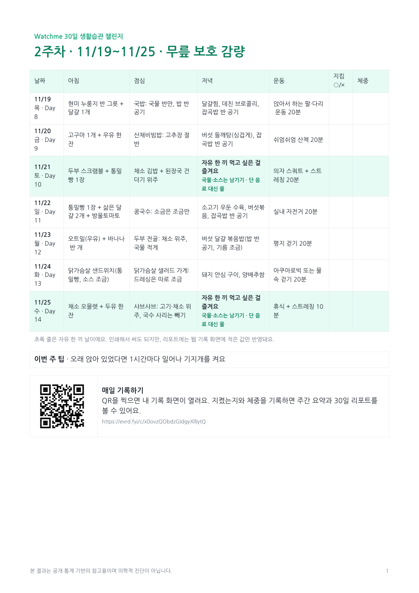</p>

<details><summary>텍스트 설계도(설명 포함)</summary>

```
┌───────────────────────────────────────────────┐
│ WATCHME  n주차 · 11/16~11/22 · 가벼운 감량 · 강도 0단계 │
├──────┬──────┬──────┬──────┬──────┬────┬─────┤
│요일·날짜│ 아침 │ 점심 │ 저녁 │ 운동 │ ○× │ 체중 │
│ 월 11/16│ …   │ …   │ …   │ …   │    │     │
│ 목 11/19│ …   │ …   │🎉자유 한 끼│ … │    │     │ ← 강조
│  …(7행) │                                      │
├───────────────────────────────────────────────┤
│ 이번 주 팁: …                    [QR 기록 화면] │
│ 면책 문구                                      │
└───────────────────────────────────────────────┘
(1주차만 2쪽) 내 결과 요약: 나 vs 한국 평균(키·몸무게·BMI), 참고 위험도, 1년 시나리오(3·6·12개월)
```

</details>

### ⑧ 30일 리포트 `/c/{token}/report` (`report.html`)

<p>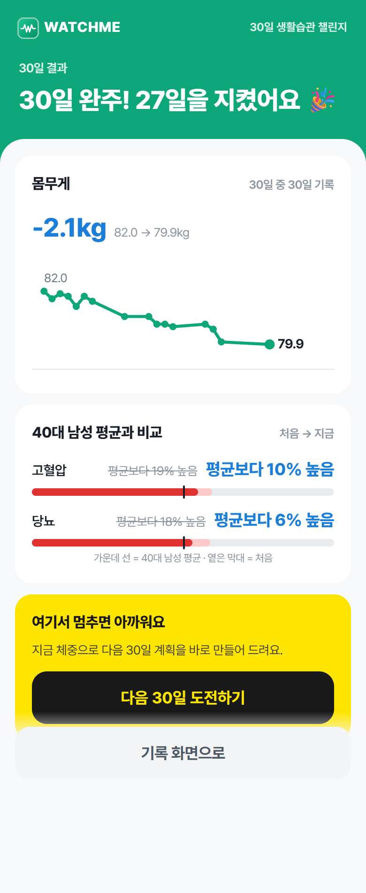</p>

<details><summary>텍스트 설계도(설명 포함)</summary>

```
┌──────────────────────────────┐
│ 30일 결과                     │
│ 30일 완주! 26일을 지켰어요 🎉  │ ← 24일↑ / 12일↑ / 그 외 문구 다름
├──────────────────────────────┤
│ [카드] 몸무게  30일 중 28일 기록 │
│   −2.1kg   82.0 → 79.9kg      │
│ [카드] 40대 남성 평균과 비교  처음 → 지금 │
│   고혈압  ~~N%~~  M% (파랑)   │
│   ░░░▓▓▓▓▓|▓▓                │ ← 옅은 막대 = 처음
│   당뇨    ~~N%~~  M%          │
│ [카드] 🕵️ 마지막 주 정체 안내   │ ← 조건일 때만
│ [노란 카드] 여기서 멈추면 아까워요 │
│   지금 체중으로 다음 30일 계획을 바로 만들어 드려요. │
│   (카카오 연결 시) 새 도전도 카톡으로 이어서 알려 드려요. │
│   [ 다음 30일 도전하기 ]       │ ← 이미 만들었으면 [ 다음 도전 이어 가기 ]
├──────────────────────────────┤
│ [ 기록 화면으로 ]              │
└──────────────────────────────┘
```

</details>
- 30일 전: 제목 "N일 남았어요", "그때까지 매일 기록해 주세요…", 버튼 [ 오늘 기록하러 가기 ].
- 기록 부족(체중 2회·10일 미만): "기록이 적어서 … 변화는 참고만 해 주세요."

### ⑧-2 주간 리포트 `/c/{token}/week/{w}` (`week.html`)

<p>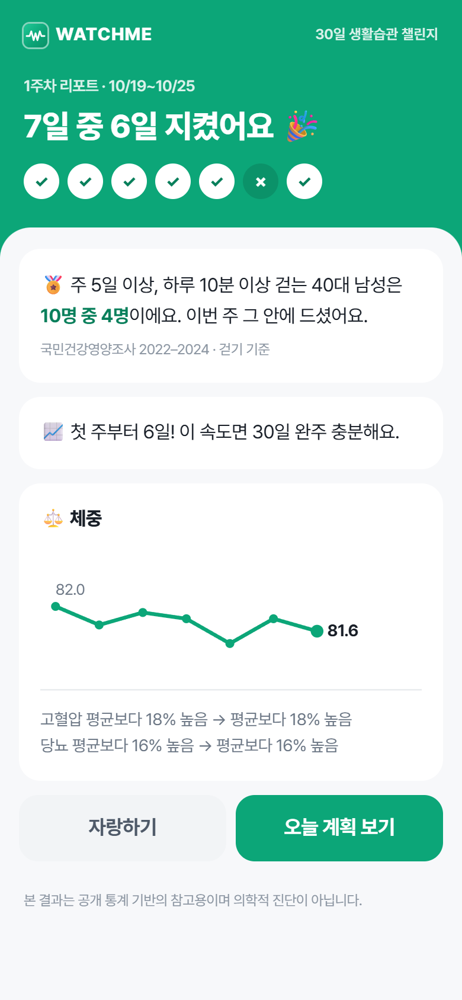 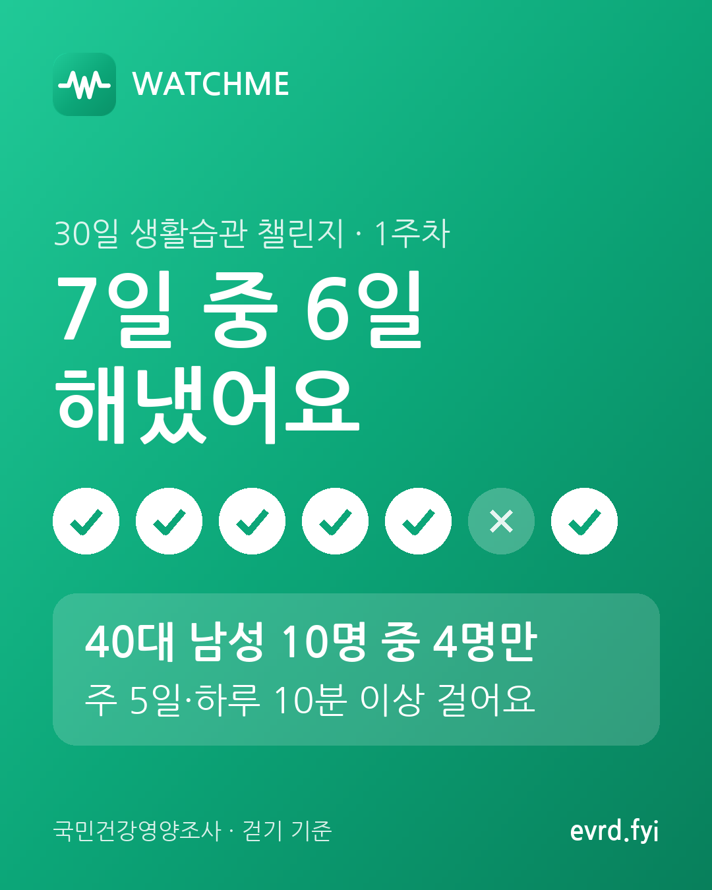</p>

<details><summary>텍스트 설계도(설명 포함)</summary>

```
┌──────────────────────────────┐ 초록 머리
│ 1주차 리포트 · 11/10~11/16    │
│ 7일 중 6일 지켰어요 🎉          │ ← 5일↑이면 🎉
│ ✓ ✓ ✓ ✗ ✓ ✓ ✓                 │ ← 지킴 / 못 지킴 / · 기록 없음
├──────────────────────────────┤
│ [카드] 🏅 주 5일 이상, 하루 10분 이상 걷는 │ ← 비율 50% 이하일 때만
│   40대 남성은 10명 중 4명이에요. 이번 주 그 안에 드셨어요. │
│   국민건강영양조사 2022–2024 · 걷기 기준 │
│ [카드] 👥 Watchme 사용자 중 상위 N% │ ← 30명 이상·50% 이내일 때만
│ [카드] 📈 첫 주부터 6일! …     │
│ [카드] ⚖️ 체중 그래프 80.0 → 79.2 │ ← 기록 없으면 "체중을 적으면 그래프가 생겨요."
│   고혈압·당뇨 평균 대비 변화    │
│ [ 자랑하기 ] [ 오늘 계획 보기 ]  │ ← 자랑하기는 또래 비교가 있을 때만
└──────────────────────────────┘
```

</details>
- 자랑 카드(1080×1350): WATCHME 로고 · "30일 생활습관 챌린지 · N주차" · "7일 중 k일 해냈어요" · 점 7개 · "40대 남성 10명 중 4명만 / 주 5일·하루 10분 이상 걸어요" · 출처 · evrd.fyi.
- 기록 화면의 주간 요약 카드에 "주간 리포트 보기 →", 30일 리포트 몸무게 카드에 체중 그래프.

### ⑧-3 운영 지표 `/admin` (`admin.html`, 관리자만)

<p>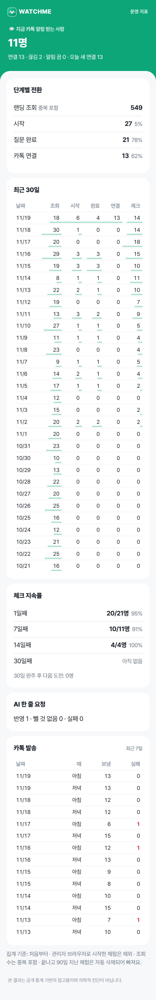</p>

<details><summary>텍스트 설계도(설명 포함)</summary>

```
┌──────────────────────────────┐ 초록 머리 (오른쪽 위 "운영 지표")
│ 💬 지금 카톡 알림 받는 사람     │
│ 22명                          │ ← 가장 큰 숫자
│ 연결 26 · 끊김 4 · 알림 끔 0 · 오늘 새 연결 2 │
├──────────────────────────────┤
│ [카드] 단계별 전환              │
│   랜딩 조회(중복 포함) 744      │
│   시작 56  8% · 질문 완료 48 86% · 카톡 연결 26 54% │
│ [카드] 최근 30일 (표, 칸 아래 막대) │ ← 좁으면 가로 스크롤
│   날짜 조회 시작 완료 연결 체크  │
│ [카드] 체크 지속률 1·7·14·30일째 │ ← 대상 없으면 "아직 없음"
│   30일 완주 후 다음 도전: N명   │
│ [카드] AI 한 줄 요청 반영·뺄 것 없음·실패 │
│ [카드] 카톡 발송 최근 7일 (실패는 빨간 글씨) │ ← 없으면 "기록 없음"
│ 집계 기준 안내 (테스트 제외·중복 포함·90일 삭제) │
└──────────────────────────────┘
```

</details>

### ⑨ 안내·오류 (`error.html`)

<p>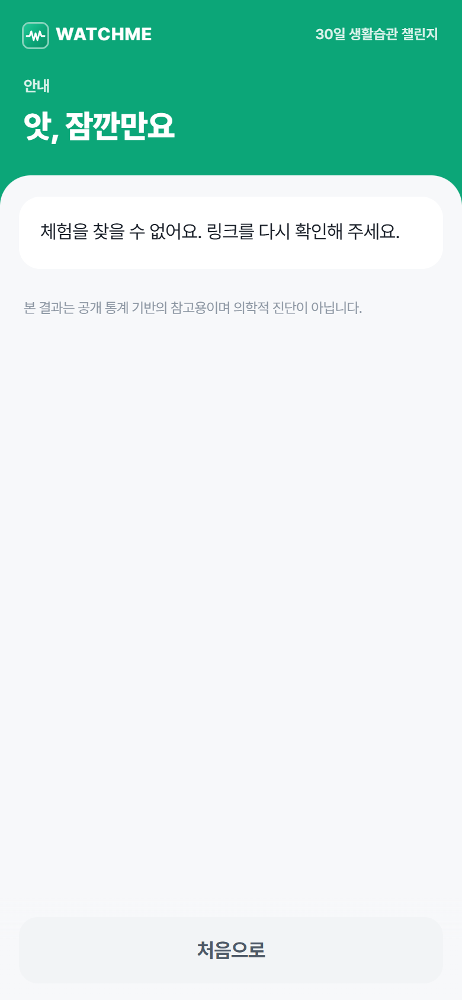</p>

<details><summary>텍스트 설계도(설명 포함)</summary>

```
┌──────────────────────────────┐
│ 안내                          │
│ 앗, 잠깐만요                  │
├──────────────────────────────┤
│ [카드] {상황별 한 줄 메시지}   │
├──────────────────────────────┤
│ [ 처음으로 ]                  │
└──────────────────────────────┘
```

</details>

| 코드 | 메시지 예 |
|---|---|
| 404 | 체험을 찾을 수 없어요. 링크를 다시 확인해 주세요. |
| 400 | 아직 기록할 수 없는 날이에요. / 몸무게는 30~250 사이 숫자로 입력해 주세요. |
| 429 | 요청이 너무 많아요. 잠시 후 다시 시도해 주세요. |
| 503 | 통계 데이터를 준비 중이에요. 곧 열릴 예정입니다. |
| 400 | 로그인 요청이 만료됐어요. 다시 시도해 주세요. |
| 404 | 카카오에 연결된 체험이 없어요. 새로 시작해 주세요. (이어서 하기) |
| 502 | 카카오 연결 중 문제가 생겼어요. 잠시 후 다시 시도해 주세요. |

### 카카오 메시지 (나에게 보내기, 텍스트 + 버튼 1개)

카톡 '나와의 채팅'에 쌓여요. **폰 알림은 울리지 않아요**(2026-11-17 확인).
<p>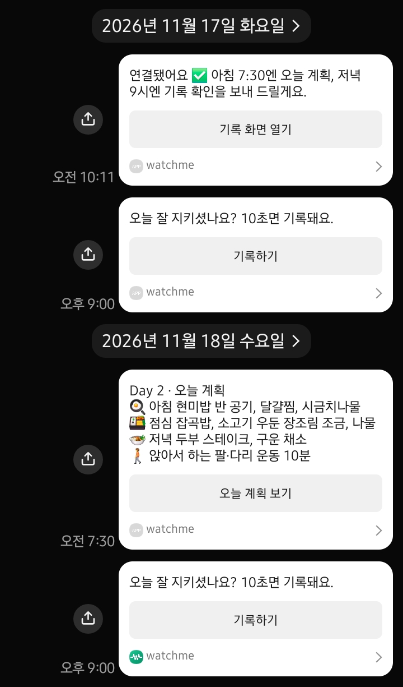</p>

_실제 운영 메시지(2026-11-17~18, 개발자 본인 폰): 연결 직후 환영 → 저녁 9시 기록 확인 → 다음 날 아침 7:30 Day 2 계획. 이름이 보이는 윗부분은 잘라냈어요._


| 때 | 내용 | 버튼 |
|---|---|---|
| 연결 직후 | 연결됐어요 ✅ 아침 7:30엔 오늘 계획, 저녁 9시엔 기록 확인을 보내 드릴게요. 폰 알림은 울리지 않으니 '나와의 채팅'을 직접 열어 확인해 주세요. | 기록 화면 열기 |
| 07:30 | Day n · 오늘 계획 + 아침·점심·저녁·운동 한 줄씩 (일요일: 오늘은 체중 재는 날이에요 ⚖️) | 오늘 계획 보기 |
| 21:00 (미기록) | 오늘 잘 지키셨나요? 10초면 기록돼요. (일요일: + 체중도 같이 적어 주세요.) | 기록하기 |
| 21:00 (기록함) | 오늘 기록 고마워요. 바꿀 게 있으면 눌러 주세요. | 기록 보기 |
| 31일째 07:30 | 30일 완주! 리포트가 나왔어요 🎉 | 리포트 보기 |
