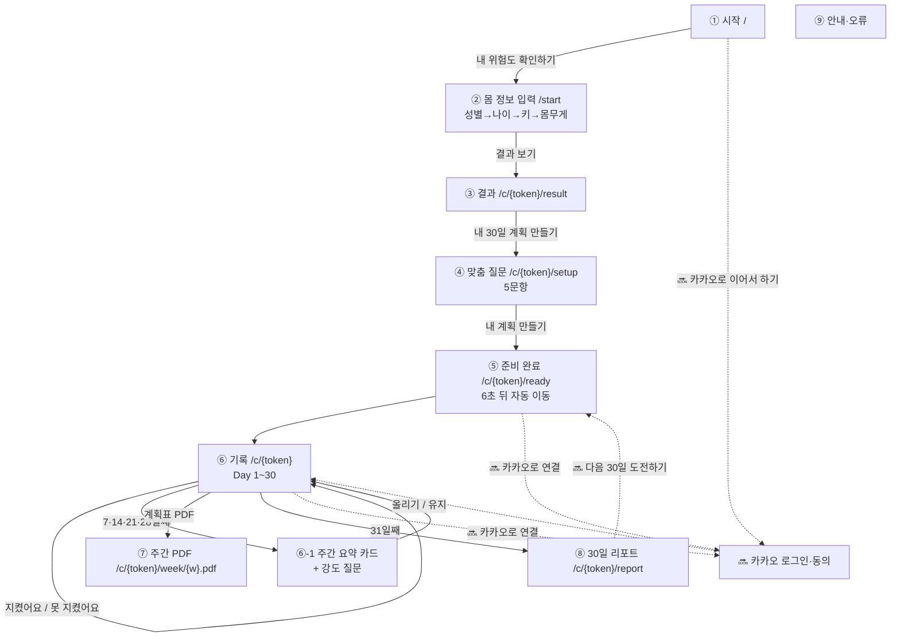

# 와이어프레임

- 기준: `app/templates/*.html` (실제 화면 문구 그대로), 실제 화면은 https://evrd.fyi
- 공통 레이아웃(`base.html`): **위 초록 영역**(브랜드·제목·핵심 숫자) + **아래 흰 시트**(카드들, 맨 아래 면책 문구) + **아래 고정 둥근 주 버튼**. 폭 최대 480px, 폰 우선, 다크 모드 지원.
- 🔜 표시는 2단계 예정(아직 구현 전) 요소예요.

## 1. 화면 흐름



- 맞춤 질문을 안 끝낸 체험이 기록·리포트·PDF에 오면 ④로 돌려보내요.
- 🔜 매일 07:30·21:00 카톡 메시지의 버튼은 ⑥(31일째 아침은 ⑧)으로 연결돼요.

## 2. 화면별 와이어프레임

### ① 시작 화면 `/` (`landing.html`)

```
┌──────────────────────────────┐
│ WATCHME 30일 생활습관 챌린지   │ ← 초록 영역
│                              │
│ 내 혈압·혈당 위험,            │
│ 같은 나이대·성별              │
│ 평균과 비교해 보세요          │
│ 국민건강영양조사(2022–2024)   │
│ 성인 약 1만 7천 명 데이터로…  │
├──────────────────────────────┤
│ [카드] 예시 · 45세 남성 172cm 82kg │ ← 흰 시트
│  고혈압        평균보다 N% 높음 │
│  ▓▓▓▓▓▓▓▓|▓▓▓░░░            │ ← 가운데 선 = 평균
│  당뇨          평균보다 N% 높음 │
│  ▓▓▓▓▓▓▓▓|▓░░░░░            │
│  가운데 선 = 40대 남성 평균    │
│ ┌────┐┌────┐┌────┐          │
│ │1분 ││맞춤││0원 │          │
│ │간단 ││30일││무료 │          │
│ │입력 ││계획││체험 │          │
│ └────┘└────┘└────┘          │
│ [카드] 🔒 이름·연락처는 받지 않아요 │
│  수집 항목: … 보관: 체험 종료 후 90일 │
│ 🔜 이미 하고 있나요? 카카오로 이어서 하기 │
│ (면책 문구)                   │
├──────────────────────────────┤
│ [ 내 위험도 확인하기 ]  (검정) │ ← 고정 버튼
└──────────────────────────────┘
```
- 통계 파일이 없으면 카드 대신 "준비 중 · 한국 평균 통계 데이터를 준비하고 있어요", 버튼 숨김.

### ② 몸 정보 입력 `/start` (`start.html` + `flow.js`)

```
┌──────────────────────────────┐
│ 1분이면 돼요                  │
│ 내 몸 정보를 알려주세요        │
├──────────────────────────────┤
│ ←  ▓▓▓▓░░░░░░░░  1/4          │ ← 진행 막대
│                              │
│ 성별을                        │
│ 알려주세요                    │
│  ┌─────────┐ ┌─────────┐     │
│  │  남성   │ │  여성   │     │ ← 누르면 바로 다음
│  └─────────┘ └─────────┘     │
│ 통계는 성별·나이대별로 달라서 필요해요. │
│ ── 답한 항목(누르면 돌아감) ── │
├──────────────────────────────┤
│ [ 다음 ] → 마지막 질문에서 [ 결과 보기 ] │
└──────────────────────────────┘
```

| 단계 | 질문 | 입력 | 안내 |
|---|---|---|---|
| 1/4 | 성별을 알려주세요 | 남성 / 여성 | 통계는 성별·나이대별로 달라서 필요해요. |
| 2/4 | 나이가 어떻게 되세요? | 숫자 키패드 `__ 세` | 18~100세 사이로 입력해 주세요. |
| 3/4 | 키는 몇 cm인가요? | `___ cm` | 120~220cm 사이로 입력해 주세요. |
| 4/4 | 몸무게는 몇 kg인가요? | `___ kg` | 30~250kg 사이로 입력해 주세요. |

- 질문 사이 좌우 슬라이드. JS가 꺼지면 4문항이 한 화면 일반 폼. 서버 오류는 맨 위 빨간 안내(`role="alert"`).

### ③ 결과 `/c/{token}/result` (`result.html`)

```
┌──────────────────────────────┐
│ 45세 남성 · BMI 27.7          │
│ 고혈압·당뇨 위험이            │
│ 평균보다 높은 편이에요         │ ← 수준별 3가지 문장
├──────────────────────────────┤
│ [카드] 고혈압 / 당뇨 막대 2개  │
│ ┌ 계획대로 3개월 꾸준히 하면    │
│ │ 당뇨 평균보다 N% 높음 →      │
│ └ 평균보다 M% 높음까지 낮아질 수 있어요 │
│ 다음은 생활 질문 5개예요. 답에 맞춰 │
│ 식단·운동 계획을 만들어 드려요. │
├──────────────────────────────┤
│ [ 내 30일 계획 만들기 ]        │
└──────────────────────────────┘
```
- 제목: 둘 다 낮음 → "평균보다 낮아요 👏" / 하나라도 높음 → "○○ 위험이 평균보다 높은 편이에요" / 그 외 → "평균 근처예요".
- BMI 23 미만이면 시나리오 대신 "지금 체중이 좋아요. 30일 동안 습관을 다져서 유지하는 게 목표예요."

### ④ 맞춤 질문 `/c/{token}/setup` (`setup.html`)

제목: "맞춤 계획 · 생활에 맞춰 30일 계획을 짜 드릴게요". ②와 같은 한 질문씩 방식.

| 단계 | 질문 | 선택지 | 안내 |
|---|---|---|---|
| 1/5 | 평소 어떤 음식을 좋아하세요? | 🥗 채식 위주 / 🍖 고기·생선 좋아함 / 🍱 골고루 | 채식 위주면 고기·생선 없이 달걀·두부·유제품으로 짜요. |
| 2/5 | 점심은 주로 어디서 드세요? | 🏠 집밥 / 🏢 회사·외식 / 🏪 편의점 | 외식·편의점이면 메뉴 고르는 요령으로 알려 드려요. |
| 3/5 | 아침은 어떻게 드세요? | ☕ 거의 안 먹음 / 🍌 간단히 / 🍚 챙겨 먹음 | 안 먹는 편이면 아주 간단한 것부터 시작해요. |
| 4/5 | 하루에 운동할 시간은 얼마나 되세요? | 10분 / 20~30분 / 1시간 | 첫 주는 가볍게 시작해서 조금씩 늘려요. |
| 5/5 | 자유 한 끼 요일 2개를 골라 주세요 | 월 화 수 목 금 토 일 (2개) | 고른 요일 저녁엔 먹고 싶은 걸 즐겨요 🎉 |

버튼: [ 내 계획 만들기 ]

### ⑤ 준비 완료 `/c/{token}/ready` (`ready.html`)

```
┌──────────────────────────────┐
│ 계획 준비 완료                │
│ 우리 30일 챌린지,             │
│ 같이 힘내 봐요! 💪            │
│ ▓▓▓▓▓▓▓░░░ (6초 진행 막대)    │
│ Day 1 계획을 여는 중이에요… 바로 시작 │
├──────────────────────────────┤
│ 🔜 [노란 카드] 카톡으로 아침 계획·저녁 체크 받기 │
│              [ 카카오로 연결 ] │ ← 이때는 자동 이동 안 함
│ [카드] 시작 전에 꼭 확인해 주세요 │
│  • 의학적 진단이 아니에요      │
│  • 치료 중이면 의료진 안내가 먼저 │
│  • 운동 중 가슴 통증·어지러움 → 멈추고 진료 │
│  • 굶거나 급하게 빼지 않아요    │
└──────────────────────────────┘
```

### ⑥ 기록 `/c/{token}` (`check.html`) — 매일 쓰는 화면

```
┌──────────────────────────────┐
│ WATCHME  가벼운 감량 (계획 종류)│
│        ◯ 5/30  (진행 링)      │
│ Day 5                         │
│ 5일 연속 지키는 중이에요 🔥    │
│ [💪 강도 1단계 진행 중]        │ ← 강도 올렸을 때만
├──────────────────────────────┤
│ [주간 요약 카드] ← 7·14·21·28일째 │
│ [카드] 오늘의 계획  11/20 목   │
│  🍳 아침  …                   │
│  🥗 점심  …                   │
│  🍽️ 저녁  … (자유 한 끼 날: 🎉 + 요령) │
│  🚶 운동  …                   │
│  ⚖️ 체중 (선택) [____] kg     │
│  [ 지켰어요 ] [ 못 지켰어요 ]  │
│  ✅ 지켰어요 · 다시 누르면 바뀌어요 │
│ [카드] 💡 오늘의 팁            │
│ [카드] 🕵️ 잠깐, 정말 다 지켰어요? │ ← 정체 조건일 때만
│ [카드] 30일 기록  5일 중 5일 지킴 │
│  ① ② ③ ④ [5] 6 7 … 30        │ ← 도장판(초록/연빨강/흐림)
│  지난 날짜를 누르면 고칠 수 있어요 │
│ [ 30일 변화 리포트 보기 🎉 ]   │ ← 31일째부터
│ [카드] 참고 위험도  BMI · 구간  │
│  고혈압 … / 당뇨 …            │
│  [ 📄 1주차 계획표 PDF ]       │
│ 🔜 💬 카톡 알림 켜짐 · 끄기 · 연결 끊기 │
│ 이 페이지 주소가 내 기록 열쇠예요. │
└──────────────────────────────┘
```
- 연속 문구: 2일 이상 "N일 연속 지키는 중이에요 🔥" / 첫날 "오늘이 첫날이에요. 가볍게 시작해요 🌱" / 그 외 "오늘 하루만 지켜도 충분해요 💪".
- 의심 카드: "꾸준히 지켰는데 체중이 그대로네요." + 원인 하나(음료 당 / 간식 / 소스·국물 / 양) + "물 무게 때문에 1~2주 정체는 흔해요."

#### ⑥-1 주간 요약 카드

```
│ 📅 1주차 요약   7일 중 6일 지킴  │
│  −0.8kg   82.0 → 81.2kg        │
│  고혈압 평균보다 N% → M%        │
│  당뇨   평균보다 N% → M%        │
│ ┌ 잘 지켰는데 체중이 그대로예요. │ ← 정체 조건일 때만
│ │ 다음 주는 조금 더 해볼까요?    │
│ │ • 저녁 밥 양 1/3 • 7시 이후 금식 • 운동 10분 더 │
│ └ [ 올리기 ] [ 이대로 유지 ]    │
│ [ 다음 주 계획표 받기 ]         │
```

### ⑦ 주간 계획표 PDF `/c/{token}/week/{w}.pdf`

```
┌───────────────────────────────────────────────┐
│ WATCHME  n주차 · 11/16~11/22 · 가벼운 감량 · 강도 0단계 │
├──────┬──────┬──────┬──────┬──────┬────┬─────┤
│요일·날짜│ 아침 │ 점심 │ 저녁 │ 운동 │ ○× │ 체중 │
│ 월 11/16│ …   │ …   │ …   │ …   │    │     │
│ 목 11/19│ …   │ …   │🎉자유 한 끼│ … │    │     │ ← 강조
│  …(7행) │                                      │
├───────────────────────────────────────────────┤
│ 이번 주 팁: …                    [QR 기록 화면] │
│ 면책 문구                                      │
└───────────────────────────────────────────────┘
(1주차만 2쪽) 내 결과 요약: 나 vs 한국 평균(키·몸무게·BMI), 참고 위험도, 1년 시나리오(3·6·12개월)
```

### ⑧ 30일 리포트 `/c/{token}/report` (`report.html`)

```
┌──────────────────────────────┐
│ 30일 결과                     │
│ 30일 완주! 26일을 지켰어요 🎉  │ ← 24일↑ / 12일↑ / 그 외 문구 다름
├──────────────────────────────┤
│ [카드] 몸무게  30일 중 28일 기록 │
│   −2.1kg   82.0 → 79.9kg      │
│ [카드] 40대 남성 평균과 비교  처음 → 지금 │
│   고혈압  ~~N%~~  M% (파랑)   │
│   ░░░▓▓▓▓▓|▓▓                │ ← 옅은 막대 = 처음
│   당뇨    ~~N%~~  M%          │
│ [카드] 🕵️ 마지막 주 정체 안내   │ ← 조건일 때만
│ [노란 카드] 여기서 멈추면 아까워요 │
│   지금: 카카오톡으로 이어가기 (곧 오픈, 비활성) │
│   🔜 지금 체중으로 다음 30일 계획을 바로 만들어 드려요. │
│   🔜 [ 다음 30일 도전하기 ]    │
├──────────────────────────────┤
│ [ 기록 화면으로 ]              │
└──────────────────────────────┘
```
- 30일 전: 제목 "N일 남았어요", "그때까지 매일 기록해 주세요…", 버튼 [ 오늘 기록하러 가기 ].
- 기록 부족(체중 2회·10일 미만): "기록이 적어서 … 변화는 참고만 해 주세요."

### ⑨ 안내·오류 (`error.html`)

```
┌──────────────────────────────┐
│ 안내                          │
│ 앗, 잠깐만요                  │
├──────────────────────────────┤
│ [카드] {상황별 한 줄 메시지}   │
├──────────────────────────────┤
│ [ 처음으로 ]                  │
└──────────────────────────────┘
```

| 코드 | 메시지 예 |
|---|---|
| 404 | 체험을 찾을 수 없어요. 링크를 다시 확인해 주세요. |
| 400 | 아직 기록할 수 없는 날이에요. / 몸무게는 30~250 사이 숫자로 입력해 주세요. |
| 429 | 요청이 너무 많아요. 잠시 후 다시 시도해 주세요. |
| 503 | 통계 데이터를 준비 중이에요. 곧 열릴 예정입니다. |
| 🔜 400 | 로그인 요청이 만료됐어요. 다시 시도해 주세요. |
| 🔜 502 | 카카오 연결 중 문제가 생겼어요. 잠시 후 다시 시도해 주세요. |

### 🔜 카카오 메시지 (나에게 보내기, 텍스트 + 버튼 1개)

| 때 | 내용 | 버튼 |
|---|---|---|
| 연결 직후 | 연결됐어요 ✅ 아침 7:30엔 오늘 계획, 저녁 9시엔 기록 확인을 보내 드릴게요. | 기록 화면 열기 |
| 07:30 | Day n · 오늘 계획 + 아침·점심·저녁·운동 한 줄씩 (일요일: 오늘은 체중 재는 날이에요 ⚖️) | 오늘 계획 보기 |
| 21:00 (미기록) | 오늘 잘 지키셨나요? 10초면 기록돼요. | 기록하기 |
| 21:00 (기록함) | 오늘 기록 고마워요. 바꿀 게 있으면 눌러 주세요. | 기록 보기 |
| 31일째 07:30 | 30일 완주! 리포트가 나왔어요 🎉 | 리포트 보기 |
